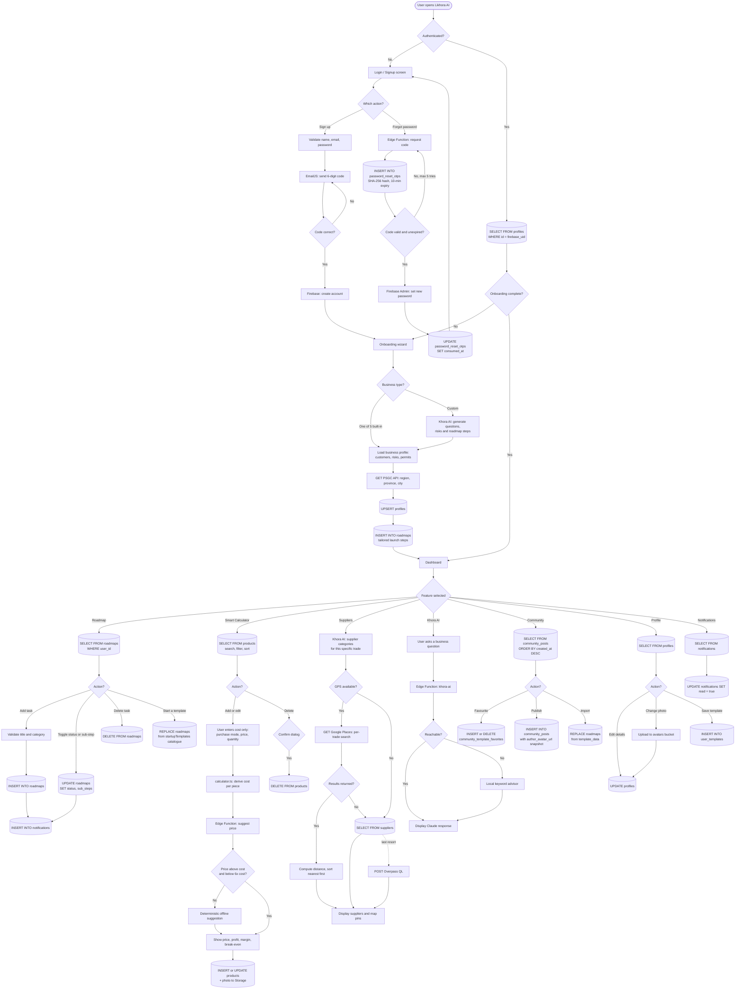

# LikhAI - API & Data Integration Submission Report

## 1. Brief API Documentation

### A. OpenStreetMap Overpass API
- **API Name**: OpenStreetMap Overpass API
- **API Endpoint(s) Used**: `https://overpass-api.de/api/interpreter`
- **Request Method(s) Implemented**: `POST` (sending Overpass QL query string with `Content-Type: application/x-www-form-urlencoded`)
- **Features Added Through API Integration**:
  - **Live Geolocation & Nearby Wholesale Supplier Discovery**: Dynamically locates real verified markets, supermarkets, malls, and wholesale stores within a 15 km radius of the user's GPS / city coordinates.
  - **Haversine Distance Calculation & Dynamic Sorting**: Calculates straight-line distance in kilometers from the user's current location to each supplier pin and sorts results nearest-first.
  - **Address Formatting & Contact Details Extraction**: Automatically extracts street, barangay, city, and phone tags from OSM nodes/ways for display on the Suppliers tab.

### B. Supabase Database REST API
- **API Name**: Supabase Database REST API (PostgreSQL PostgREST client)
- **API Endpoint(s) Used**: `https://<YOUR_SUPABASE_PROJECT_REF>.supabase.co/rest/v1/suppliers`
- **Request Method(s) Implemented**: `GET` (via Supabase JS SDK `.select('*')` with `.ilike()` and `.eq()` query filters)
- **Features Added Through API Integration**:
  - **Location & Category Search Fallback**: Serves pre-configured, categorized wholesale suppliers filtered by category (`Rice & Grains`, `Meat`, `Packaging`, etc.) and fuzzy text query (`searchQuery`).
  - **Persistent Supplier Database**: Stores custom price ranges, contact numbers, and rating metrics that are preserved even when external APIs time out.

### C. Philippine Standard Geographic Code (PSGC) API
- **API Name**: Philippine Standard Geographic Code (PSGC) API
- **API Endpoint(s) Used**: `https://psgc.gitlab.io/api/regions/`
- **Request Method(s) Implemented**: `GET`
- **Features Added Through API Integration**:
  - **Seamless Address & City Selection**: Dynamically populates dropdowns for 17 regions, 82 provinces, and 1,600+ municipalities during user onboarding and location selection.

### D. Google Places API (New) — optional, richer supplier data
- **API Name**: Google Places API (New)
- **API Endpoint(s) Used**: `https://places.googleapis.com/v1/places:searchNearby`, `places:searchText`, and the Photo Media endpoint (`src/services/places.ts`)
- **Request Method(s) Implemented**: `POST` (nearby/text search, requires an `X-Goog-Api-Key` header and field mask), `GET` (photo retrieval)
- **Features Added Through API Integration**:
  - **Accurate, photo-rich supplier listings**: when a Google Places API key is configured (`EXPO_PUBLIC_GOOGLE_PLACES_API_KEY`), suppliers are sourced from real, verified business listings with real photos, ratings, and price levels, tried before the OpenStreetMap/Supabase fallbacks described above.
  - **Business-type-aware filtering**: search categories and an irrelevant-listing filter are tailored to the user's onboarding business type, so e.g. a Carinderia owner sees rice/meat/ingredient suppliers rather than unrelated wholesale categories.
  - This integration is fully optional — without a key, the app transparently falls back to the free Overpass/Nominatim/Supabase chain with no functional loss beyond photo richness.

### E. Firebase Authentication + Supabase Row Level Security (data access control)
- **What it is**: this app authenticates users via Firebase, not Supabase's own Auth. Firebase is configured as a Supabase Third-Party Auth provider (Supabase Dashboard → Authentication → Third Party Auth), so every Supabase request (`src/services/supabase.ts`) carries the current Firebase user's verified ID token.
- **Why it matters**: Postgres Row Level Security policies (`supabase/05_secure_user_data.sql`) enforce, at the database level, that a user can only read or write their own `roadmaps`, `profiles`, and `notifications` rows — verified directly by attempting unauthenticated reads/writes with the app's public anon key and confirming they are rejected. `community_posts` and `suppliers` remain intentionally public-readable, since they're shared reference/community data by design.

---

## 2. Updated Project Source Code Overview

The project relies on a modular architecture separating UI screens, API services, database integrations, and global context state:

- **`src/app/(tabs)/suppliers.tsx`**: Primary screen rendering verified local suppliers, a real embedded/auto-updating map, distance calculation (Haversine formula), search/filter controls (distance, rating, price, photo), category chips, and an explicit device-vs-saved-location source toggle.
- **`src/app/template-builder.tsx`**: Lets a user build a custom multi-step roadmap template from scratch and save it to their personal template library.
- **`src/app/(tabs)/community.tsx`**: The "Likha Community" tab — users pick which of their saved templates (or their active roadmap) to publish, browse/favorite others' templates, and import them.
- **`src/services/supabase.ts`**: Supabase client service handling CRUD operations for user profiles, roadmaps, notifications, community templates, personal template library, and database supplier queries. Also configures Firebase-token-authenticated requests for Row Level Security (see Section 1E).
- **`src/services/places.ts`**: Google Places API (New) integration for accurate, photo-rich supplier search, with business-type-aware filtering.
- **`src/services/location.ts`**: Philippine Standard Geographic Code (PSGC) API service supporting 17 regions, 82 provinces, and 1,600+ municipalities with fallback datasets, plus device GPS (via `expo-location`) and forward-geocoding of saved locations.
- **`supabase/01_crud_and_community.sql`** through **`07_profile_preferences.sql`**: Incremental schema migrations — see [`CRUD.md`](./CRUD.md) for the full run order and what each one does.

---

## 2. API Request Implementation

LikhAI implements a hybrid data fetching model: live OpenStreetMap Overpass API for real-world verified commercial locations near the user, backed up by Supabase PostgreSQL query fallback.

### A. OpenStreetMap Overpass API Integration (`src/app/(tabs)/suppliers.tsx`)
```typescript
// Fetch REAL Verified Commercial Businesses, Malls, Supermarkets & Wholesalers via OpenStreetMap Overpass API
const fetchRealOverpassSuppliers = async (lat: number, lng: number, cityName: string): Promise<SupplierItem[]> => {
  const overpassQuery = `
    [out:json][timeout:5];
    (
      nwr["shop"="supermarket"](around:15000,${lat},${lng});
      nwr["shop"="mall"](around:15000,${lat},${lng});
      nwr["shop"="grocery"](around:15000,${lat},${lng});
      nwr["amenity"="marketplace"](around:15000,${lat},${lng});
      nwr["shop"="wholesale"](around:15000,${lat},${lng});
    );
    out center tags 25;
  `;

  const controller = new AbortController();
  const timeoutId = setTimeout(() => controller.abort(), 4000);

  try {
    const res = await fetch('https://overpass-api.de/api/interpreter', {
      method: 'POST',
      headers: { 'Content-Type': 'application/x-www-form-urlencoded' },
      body: overpassQuery,
      signal: controller.signal,
    });
    clearTimeout(timeoutId);

    if (res.ok) {
      const data = await res.json();
      if (data.elements && data.elements.length > 0) {
        const items: SupplierItem[] = data.elements.map((el: any, idx: number) => ({
          id: `op-${el.id || idx}`,
          name: el.tags?.name || el.tags?.brand || el.tags?.operator || 'Unnamed business',
          category: formatCategory(el.tags?.shop || el.tags?.amenity),
          distance: `${getDistanceFromLatLonInKm(lat, lng, el.lat ?? el.center?.lat, el.lon ?? el.center?.lon).toFixed(1)} km`,
          location: formatDetailedAddress(el.tags, cityName),
          tags: ['Wholesale Market', 'OpenStreetMap location'],
          price_range: 'Not published by this listing',
          phone: el.tags?.phone || el.tags?.['contact:phone'] || '',
          lat: el.lat ?? el.center?.lat,
          lng: el.lon ?? el.center?.lon,
        }));
        items.sort((a, b) => parseFloat(a.distance) - parseFloat(b.distance));
        return items;
      }
    }
  } catch (e) {
    clearTimeout(timeoutId);
  }
  return [];
};
```

### B. Supabase Database API Request (`src/services/supabase.ts`)
```typescript
// Fetch Suppliers from Supabase Database Filtered by User Location & Category
export const fetchSuppliersFromSupabase = async (category?: string, searchQuery?: string, locationFilter?: string) => {
  try {
    let query = supabase.from('suppliers').select('*');

    if (locationFilter && locationFilter !== 'Philippines' && locationFilter !== 'your area') {
      query = query.ilike('location', `%${locationFilter}%`);
    }

    if (category && category !== 'All') {
      query = query.eq('category', category);
    }

    if (searchQuery && searchQuery.trim()) {
      query = query.ilike('name', `%${searchQuery.trim()}%`);
    }

    const { data, error } = await query;
    return { data, error };
  } catch (err) {
    return { data: null, error: err };
  }
};
```

---

## 3. JSON Response Samples

### Sample 1: Supabase Database `suppliers` Table JSON Response
```json
[
  {
    "id": "sup-001",
    "name": "Divisoria Wholesale Packaging & Grains",
    "category": "Rice & Grains",
    "rating": 4.8,
    "distance": "2.4 km",
    "location": "Recto Ave, Divisoria, Manila, Metro Manila",
    "tags": [
      "Wholesale Market",
      "Bulk Discounts",
      "Verified Supplier"
    ],
    "price_level": "₱₱",
    "price_range": "₱45 - ₱55 per kg (Bulk)",
    "phone": "+639171234567",
    "lat": 14.6037,
    "lng": 120.9723,
    "created_at": "2026-08-01T08:00:00.000Z"
  },
  {
    "id": "sup-002",
    "name": "Balintawak Fresh Meat & Poultry Supply",
    "category": "Meat",
    "rating": 4.6,
    "distance": "5.1 km",
    "location": "Balintawak Market, Quezon City, Metro Manila",
    "tags": [
      "Fresh Meat",
      "Pakyawan"
    ],
    "price_level": "₱₱",
    "price_range": "Contact supplier for current prices",
    "phone": "+639189876543",
    "lat": 14.6576,
    "lng": 121.0028,
    "created_at": "2026-08-05T10:30:00.000Z"
  }
]
```

### Sample 2: Overpass API Live External HTTP Response
```json
{
  "version": 0.6,
  "generator": "Overpass API 0.7.62",
  "osm3s": {
    "timestamp_osm_base": "2026-08-17T02:00:00Z"
  },
  "elements": [
    {
      "type": "node",
      "id": 482910384,
      "lat": 14.8624,
      "lon": 120.8143,
      "tags": {
        "name": "Malolos Public Market",
        "shop": "supermarket",
        "amenity": "marketplace",
        "addr:street": "McArthur Highway",
        "addr:city": "Malolos",
        "addr:province": "Bulacan",
        "contact:phone": "+63447910000"
      }
    },
    {
      "type": "way",
      "id": 192847302,
      "center": {
        "lat": 14.8512,
        "lon": 120.8201
      },
      "tags": {
        "name": "Robinsons Place Malolos",
        "shop": "mall",
        "brand": "Robinsons",
        "addr:city": "Malolos"
      }
    }
  ]
}
```

---

## 4. Data Displayed in Application

The application consumes the raw JSON response payload and transforms it into card items and interactive map pins:

1. **Category Tabs & Search**: Filters raw JSON array by category (`Rice & Grains`, `Meat`, `Packaging`, `Malls & Supermarkets`) and fuzzy text matching on names.
2. **Haversine Distance Sorting**: Automatically computes distance from user's current GPS / onboarding municipality to supplier latitude and longitude.
3. **Detail Modal & Contact**: Displays location tags, contact phone numbers (`tel:` schema trigger), and price ranges.

---

## 5. Instructions for Capturing Submission Screenshots

To capture the required screenshots for your submission:

1. **API Request Implementation**:
   - Capture a screenshot of [`src/services/supabase.ts`](file:///c:/Users/hiverpc/LikhAI/src/services/supabase.ts#L520-L541) or [`src/app/(tabs)/suppliers.tsx`](file:///c:/Users/hiverpc/LikhAI/src/app/(tabs)/suppliers.tsx#L167-L240) in your IDE showing the `fetch` / `supabase.from('suppliers')` calls.
2. **Retrieved Data Displayed in Application**:
   - Open Expo app (on mobile via Expo Go or in browser at `http://localhost:8081`).
   - Navigate to the **Suppliers** tab.
   - Take a screenshot showing the list of retrieved local suppliers, distance badges, and category chips.
3. **JSON Response Sample**:
   - Copy Section 3 of this document into your submission report or take a screenshot of the Network tab / console response log.

---

## 6. System Architecture & Flowchart Diagrams

Both diagrams below are defined in Mermaid and render directly on GitHub and in
VS Code. They are the authoritative, current version of the architecture — if a
static image is required for a printed submission, export these blocks from
[mermaid.live](https://mermaid.live) rather than reusing an older screenshot.

### A. High-Level System Architecture Diagram

**Likhora AI — 5-Tier Architecture.** The application separates presentation,
client state, client-side services, server-side Edge Functions, and the data and
external-API layer. Every arrow is labelled with the HTTP method or protocol it
actually uses.

The tier that matters most for security is **Tier 4**. The Anthropic API key and
the Firebase Admin service account are never bundled into the Expo app — anything
shipped in the bundle is readable by anyone who installs it. Both live as Supabase
secrets and are used only inside Deno Edge Functions, so the client can ask for a
price or a password reset but can never see the credentials that fulfil it.

```mermaid
graph TD
    %% ================= TIER 1 =================
    subgraph T1["TIER 1 — Presentation Layer (Expo Router, React Native)"]
        direction TB
        Auth["Auth Screens<br/>login · signup · forgot-password"]
        Onboard["Onboarding<br/>onboarding.tsx"]
        subgraph Tabs["Bottom Tab Navigation"]
            Home["Home Dashboard<br/>index.tsx"]
            Roadmap["Roadmap + Templates<br/>roadmap.tsx"]
            Suppliers["Supplier Finder<br/>suppliers.tsx"]
            Khora["Khora AI Assistant<br/>ai-assistant.tsx"]
            Community["Community Marketplace<br/>community.tsx"]
        end
        subgraph Stack["Stack Screens"]
            Calc["Smart Calculator<br/>calculator.tsx · calculator-product.tsx"]
            Profile["Profile and Settings<br/>profile.tsx"]
            Templates["Template Library<br/>my-templates.tsx · template-builder.tsx"]
            Notifs["Notifications<br/>notifications.tsx"]
        end
    end

    %% ================= TIER 2 =================
    subgraph T2["TIER 2 — Client State (React Context)"]
        AuthCtx["AuthContext<br/>session · profile · route gate"]
        NotifCtx["NotificationContext<br/>unread badge · alerts"]
    end

    %% ================= TIER 3 =================
    subgraph T3["TIER 3 — Client Services (src/services)"]
        DataSvc["Data Service<br/>supabase.ts"]
        AuthSvc["Auth Services<br/>firebase.ts · passwordReset.ts"]
        Advisors["AI Advisors<br/>pricingAdvisor · onboardingAdvisor · supplierAdvisor"]
        Domain["Domain Logic — pure, no I/O<br/>calculator.ts · businessProfiles.ts · startupTemplates.ts"]
        Geo["Location and Places<br/>location.ts · places.ts"]
        Mail["Email Service<br/>emailjs.ts"]
    end

    %% ================= TIER 4 =================
    subgraph T4["TIER 4 — Supabase Edge Functions (Deno) — SERVER-SIDE SECRETS"]
        KhoraFn["khora-ai<br/>holds ANTHROPIC_API_KEY<br/>fixes model · effort · token cap"]
        ResetFn["password-reset<br/>holds FIREBASE_SERVICE_ACCOUNT<br/>generates · hashes · verifies OTP"]
    end

    %% ================= TIER 5 =================
    subgraph T5["TIER 5 — Data and External APIs"]
        subgraph Supa["Supabase Cloud"]
            PG[("PostgreSQL — 9 tables<br/>RLS via Firebase JWT sub claim")]
            Storage[("Storage Buckets<br/>product-images · avatars")]
        end
        subgraph Ext["External REST APIs"]
            FBAuth["Firebase Authentication"]
            Anthropic["Anthropic Claude API<br/>claude-opus-5"]
            IdentityKit["Google Identity Toolkit<br/>Firebase Admin REST"]
            Places["Google Places API (New)"]
            OSM["OpenStreetMap<br/>Overpass · Nominatim"]
            PSGC["PSGC API<br/>PH regions · provinces · cities"]
            EmailJS["EmailJS<br/>OTP delivery"]
        end
    end

    %% ---------- Tier 1 to Tier 2 ----------
    AuthCtx -.->|provides session| T1
    NotifCtx -.->|provides unread count| T1

    %% ---------- Tier 1 to Tier 3 ----------
    Auth -->|sign in / sign up| AuthSvc
    Auth -->|reset request| AuthSvc
    Onboard -->|region lookup| Geo
    Onboard -->|profile for custom type| Advisors
    Roadmap -->|task CRUD| DataSvc
    Roadmap -->|template catalogue| Domain
    Suppliers -->|supplier targeting| Advisors
    Suppliers -->|place search| Geo
    Khora -->|business question| Advisors
    Community -->|posts and favourites| DataSvc
    Calc -->|cost math| Domain
    Calc -->|price suggestion| Advisors
    Calc -->|product CRUD + photo| DataSvc
    Profile -->|profile update + avatar| DataSvc
    Templates -->|template CRUD| DataSvc
    Notifs -->|read / mark read| DataSvc

    %% ---------- Tier 3 to Tier 4 ----------
    Advisors -->|POST invoke, JWT verified| KhoraFn
    AuthSvc -->|POST invoke, public| ResetFn

    %% ---------- Tier 3 direct to Tier 5 ----------
    DataSvc -->|"PostgREST: GET · POST · PATCH · DELETE"| PG
    DataSvc -->|multipart upload| Storage
    AuthSvc -->|HTTPS SDK| FBAuth
    Geo -->|GET| PSGC
    Geo -->|GET nearby / text search| Places
    Geo -->|POST Overpass QL · GET Nominatim| OSM
    Mail -->|POST send| EmailJS

    %% ---------- Tier 4 to Tier 5 ----------
    KhoraFn -->|POST /v1/messages| Anthropic
    ResetFn -->|"service role: SELECT · INSERT · UPDATE"| PG
    ResetFn -->|accounts:lookup · accounts:update| IdentityKit
    ResetFn -->|POST send code| EmailJS

    %% ---------- Auth token flow ----------
    FBAuth -.->|"ID token used as Supabase access token"| DataSvc
```



**Legend**

| Notation | Meaning |
|---|---|
| Solid arrow | A request, labelled with its HTTP method or protocol |
| Dotted arrow | State or credentials provided, not a network call |
| `[( )]` cylinder | Persistent storage |
| Tier 4 | Runs on Supabase servers; the only tier holding secrets |

**Key architectural decisions visible above**

1. **No secret ever reaches the client.** Tier 3 can invoke Tier 4, but only Tier 4 talks to Anthropic and Firebase Admin.
2. **One auth identity, two backends.** Firebase issues the ID token; Supabase accepts it as its access token, so RLS policies enforce ownership with `auth.jwt() ->> 'sub'` without a second login.
3. **Domain logic is pure.** `calculator.ts`, `businessProfiles.ts` and `startupTemplates.ts` perform no I/O, so the same functions drive the on-screen preview and the values written to the database.
4. **Every AI path degrades.** If Tier 4 is unreachable, the advisors fall back to deterministic local logic rather than failing.

### B. System Data and User Operations Flowchart

**User lifecycle and database operations.** Each terminal node names the exact SQL
operation and table involved, mapped to the 9 PostgreSQL tables in the ERD:
`profiles`, `roadmaps`, `notifications`, `suppliers`, `community_posts`,
`community_template_favorites`, `user_templates`, `products`, and
`password_reset_otps`.



**Flowchart notation**

| Notation | Meaning |
|---|---|
| `([ ])` stadium | Entry point |
| `{ }` diamond | Decision or branch |
| `[( )]` cylinder | A database or storage operation, with the exact SQL verb and table |
| `[ ]` rectangle | Client-side processing or display |
| Dotted arrow | Fallback path taken only when the preferred path fails |

---

## 7. Detailed Entity Relationship Diagram (ERD) & Database Schema

The database for **Likhora AI** is built on Supabase Cloud (PostgreSQL), consisting of 9 core relational tables: `profiles`, `roadmaps`, `notifications`, `suppliers`, `community_posts`, `community_template_favorites`, `user_templates`, `products`, and `password_reset_otps`. All tables except `suppliers` and `community_posts`/`community_template_favorites` (intentionally public/shared) are protected by Row Level Security tied to the authenticated Firebase user (see Section 1E).

`password_reset_otps` is stricter still: RLS is enabled with **zero policies**, so no client role can read or write it at all. It is reachable only by the `password-reset` Edge Function, which runs with the service role. That isolation is deliberate — a reset code readable from the client would be an account-takeover path.

### A. Visual Entity Relationship Diagram (ERD)

```mermaid
erDiagram
    profiles {
        text id PK "User ID (Firebase UID)"
        text email "User Email Address"
        text full_name "Full Name"
        text business_name "Business Title"
        text business_type "Industry / Sector"
        text budget "Initial Capital Budget"
        text experience_level "Entrepreneurial Experience"
        text location "Selected Region & Municipality"
        text launch_date "Target Business Launch Date"
        boolean onboarded "Onboarding Completion Status"
        timestamp created_at "Account Creation Timestamp"
        timestamp updated_at "Last Profile Update Timestamp"
        integer onboarding_step "Current Onboarding Step"
        text onboarding_draft "Draft JSON / Progress Data"
        text avatar_color "Fallback colour behind user initials"
        text avatar_url "Profile photo URL (avatars storage bucket)"
        boolean push_notifications_enabled "Push Notification Preference"
        boolean email_notifications_enabled "Email Notification Preference"
    }

    products {
        uuid id PK "Product Unique ID"
        text user_id FK "Owner User ID (profiles.id)"
        text name "Product Name"
        text category "Category inferred by Khora AI"
        text business_key "Roadmap this price book belongs to"
        text purchase_mode "piece | pack | case | kilo | liter"
        numeric bulk_quantity "Total quantity bought (kilo/liter modes)"
        numeric bulk_portion_size "Size of one sellable portion"
        numeric bulk_pieces_yielded "Derived piece count"
        numeric dagdag_gastos_per_piece "Extra cost per piece"
        numeric puhunan "Base cost per piece"
        numeric total_cost_per_piece "Cost incl. extra costs"
        numeric selling_price "Final price (AI suggested or adjusted)"
        numeric tubo_per_piece "Profit per piece"
        numeric margin_percent "Profit as % of price"
        numeric breakeven_units "Units to recover capital"
        text ai_reasoning "Khora AI explanation for the price"
        text price_source "ai | manual"
        timestamp created_at "Creation Timestamp"
        timestamp updated_at "Last Update Timestamp"
    }

    password_reset_otps {
        uuid id PK "Reset Request ID"
        text email "Requesting email address"
        text code_hash "SHA-256 of the 6-digit code"
        timestamp expires_at "10-minute expiry"
        integer attempts "Failed verification count (max 5)"
        timestamp consumed_at "Set once used or superseded"
        timestamp created_at "Creation Timestamp"
    }

    user_templates {
        uuid id PK "Template Unique ID"
        text user_id FK "Owner User ID (profiles.id)"
        text name "Template / Business Name"
        text business_type "Business Category"
        text summary "Template Description"
        text image_url "Optional Cover Image URL"
        jsonb template_data "Saved Roadmap Steps JSON"
        timestamp created_at "Creation Timestamp"
        timestamp updated_at "Last Update Timestamp"
    }

    roadmaps {
        uuid id PK "Roadmap Task Unique ID"
        text user_id FK "Owner User ID (profiles.id)"
        text title "Task Title"
        text category "Task Category (e.g. Finance, Legal)"
        text status "Status (Pending, In Progress, Completed)"
        text desc_text "Task Description & Guidance"
        integer step_order "Step Sequencing Index"
        timestamp created_at "Task Creation Timestamp"
        text client_key "Local Client Tracking Key"
        jsonb sub_steps "Checklist Sub-steps Array"
    }

    notifications {
        uuid id PK "Notification Unique ID"
        text user_id FK "Recipient User ID (profiles.id)"
        text title "Notification Headline"
        text desc_text "Detailed Message Body"
        text type "Category (updates, alerts, milestones)"
        boolean read "Read Status Indicator"
        timestamp created_at "Timestamp Triggered"
    }

    suppliers {
        uuid id PK "Supplier Unique ID"
        text name "Business / Market Name"
        text category "Wholesale Category"
        numeric rating "User Rating (0.0 - 5.0)"
        text distance "Distance Tag (e.g. 2.4 km)"
        text location "Formatted Address / City"
        ARRAY tags "Tag Labels (Wholesale, Pakyawan)"
        text price_level "Price Tier (₱, ₱₱, ₱₱₱)"
        text phone "Contact Phone Number"
        numeric lat "Latitude Coordinate"
        numeric lng "Longitude Coordinate"
        timestamp created_at "Record Creation Timestamp"
        text price_range "Typical Wholesale Price Range"
        text image_url "Optional Store Photo URL"
    }

    community_posts {
        uuid id PK "Community Post Unique ID"
        text author_id FK "Author User ID (profiles.id)"
        text author_name "Author Display Name"
        text business_name "Shared Business Name"
        text business_type "Business Category"
        text location "Author Region / City"
        text summary "Roadmap Template Overview"
        jsonb template_data "Exported Roadmap Steps JSON"
        timestamp created_at "Publication Timestamp"
        text image_url "Optional Banner Image URL"
    }

    community_template_favorites {
        text user_id PK,FK "User ID (profiles.id)"
        uuid post_id PK,FK "Post ID (community_posts.id)"
        timestamp created_at "Favorited Timestamp"
    }

    %% Entity Relationships
    profiles ||--o{ roadmaps : "owns (1:N user_id)"
    profiles ||--o{ notifications : "receives (1:N user_id)"
    profiles ||--o{ community_posts : "authors (1:N author_id)"
    profiles ||--o{ community_template_favorites : "favorites (1:N user_id)"
    profiles ||--o{ user_templates : "owns (1:N user_id)"
    profiles ||--o{ products : "prices (1:N user_id)"
    community_posts ||--o{ community_template_favorites : "favorited_by (1:N post_id)"
```



> `password_reset_otps` is intentionally unrelated to `profiles`: it is keyed by
> email rather than by user id, because a person resetting their password is not
> authenticated yet and has no session to join on.

### B. Detailed PostgreSQL DDL Schema Definitions

```sql
-- 1. Profiles Table
CREATE TABLE public.profiles (
  id text NOT NULL,
  email text NOT NULL,
  full_name text NOT NULL,
  business_name text DEFAULT ''::text,
  business_type text DEFAULT ''::text,
  budget text DEFAULT ''::text,
  experience_level text DEFAULT ''::text,
  location text DEFAULT ''::text,
  launch_date text DEFAULT ''::text,
  onboarded boolean DEFAULT false,
  created_at timestamp with time zone DEFAULT now(),
  updated_at timestamp with time zone DEFAULT now(),
  onboarding_step integer DEFAULT 1,
  onboarding_draft text DEFAULT ''::text,
  avatar_color text NOT NULL DEFAULT '#7C3AED',
  push_notifications_enabled boolean NOT NULL DEFAULT true,
  email_notifications_enabled boolean NOT NULL DEFAULT true,
  CONSTRAINT profiles_pkey PRIMARY KEY (id)
);

-- 2. Roadmaps Table
CREATE TABLE public.roadmaps (
  id uuid NOT NULL DEFAULT gen_random_uuid(),
  user_id text NOT NULL,
  title text NOT NULL,
  category text DEFAULT 'General'::text,
  status text DEFAULT 'Pending'::text,
  desc_text text DEFAULT ''::text,
  step_order integer DEFAULT 1,
  created_at timestamp with time zone DEFAULT now(),
  client_key text NOT NULL,
  sub_steps jsonb NOT NULL DEFAULT '[]'::jsonb,
  CONSTRAINT roadmaps_pkey PRIMARY KEY (id)
);

-- 3. Notifications Table
CREATE TABLE public.notifications (
  id uuid NOT NULL DEFAULT gen_random_uuid(),
  user_id text NOT NULL,
  title text NOT NULL,
  desc_text text DEFAULT ''::text,
  type text DEFAULT 'updates'::text,
  read boolean DEFAULT false,
  created_at timestamp with time zone DEFAULT now(),
  CONSTRAINT notifications_pkey PRIMARY KEY (id)
);

-- 4. Suppliers Table
CREATE TABLE public.suppliers (
  id uuid NOT NULL DEFAULT gen_random_uuid(),
  name text NOT NULL,
  category text DEFAULT 'General'::text,
  rating numeric DEFAULT 4.8,
  distance text DEFAULT '1.0 km'::text,
  location text DEFAULT 'Metro Manila'::text,
  tags ARRAY DEFAULT '{}'::text[],
  price_level text DEFAULT '₱'::text,
  phone text DEFAULT ''::text,
  lat numeric DEFAULT 14.6760,
  lng numeric DEFAULT 121.0437,
  created_at timestamp with time zone DEFAULT now(),
  price_range text DEFAULT 'Contact supplier for current prices'::text,
  image_url text,
  CONSTRAINT suppliers_pkey PRIMARY KEY (id)
);

-- 5. Community Posts Table
CREATE TABLE public.community_posts (
  id uuid NOT NULL DEFAULT gen_random_uuid(),
  author_id text NOT NULL,
  author_name text NOT NULL,
  business_name text NOT NULL,
  business_type text NOT NULL DEFAULT ''::text,
  location text NOT NULL DEFAULT ''::text,
  summary text NOT NULL DEFAULT ''::text,
  template_data jsonb NOT NULL DEFAULT '[]'::jsonb,
  created_at timestamp with time zone NOT NULL DEFAULT now(),
  image_url text NOT NULL DEFAULT ''::text,
  CONSTRAINT community_posts_pkey PRIMARY KEY (id)
);

-- 6. Community Template Favorites Table
CREATE TABLE public.community_template_favorites (
  user_id text NOT NULL,
  post_id uuid NOT NULL,
  created_at timestamp with time zone NOT NULL DEFAULT now(),
  CONSTRAINT community_template_favorites_pkey PRIMARY KEY (user_id, post_id),
  CONSTRAINT community_template_favorites_post_id_fkey FOREIGN KEY (post_id) REFERENCES public.community_posts(id)
);

-- 7. User Templates Table (personal template library)
CREATE TABLE public.user_templates (
  id uuid NOT NULL DEFAULT gen_random_uuid(),
  user_id text NOT NULL,
  name text NOT NULL,
  business_type text NOT NULL DEFAULT ''::text,
  summary text NOT NULL DEFAULT ''::text,
  image_url text NOT NULL DEFAULT ''::text,
  template_data jsonb NOT NULL DEFAULT '[]'::jsonb,
  created_at timestamp with time zone NOT NULL DEFAULT now(),
  updated_at timestamp with time zone NOT NULL DEFAULT now(),
  CONSTRAINT user_templates_pkey PRIMARY KEY (id)
);
```


